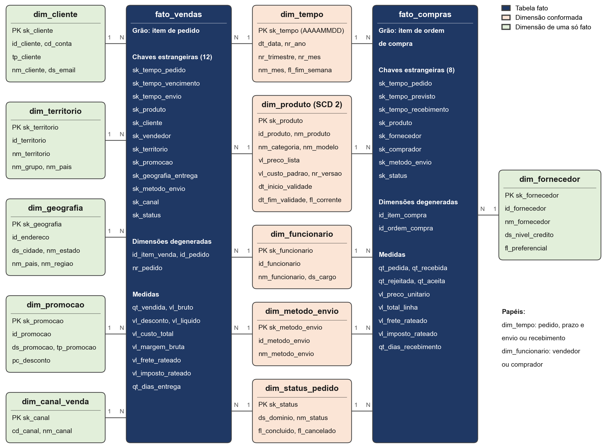
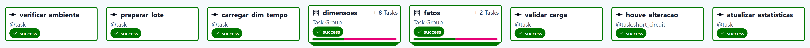
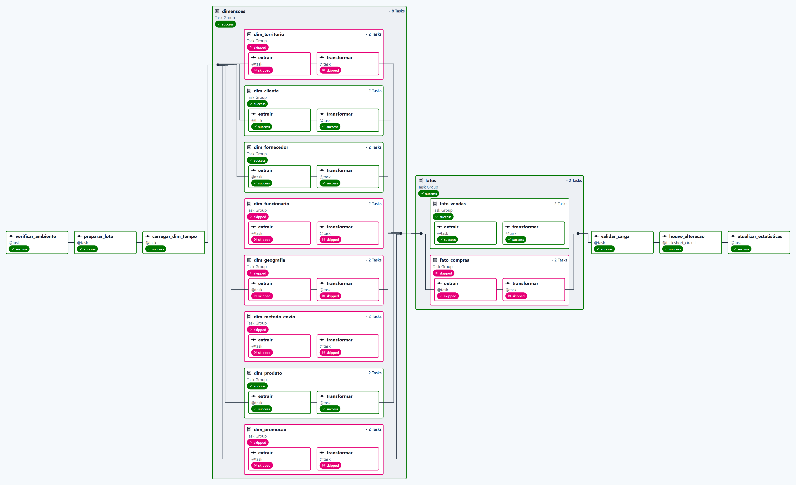

# Data Warehouse AdventureWorks orquestrado com Apache Airflow

Trabalho individual de Análise e Fluxo de Dados (OLAP e ETL). Constrói um Data
Warehouse em **PostgreSQL 16** a partir da base transacional **AdventureWorks**,
com modelo **Star Schema** e **ETL incremental orquestrada pelo Apache Airflow**.

| Item | Escolha |
|---|---|
| Origem (OLTP) | SQL Server 2022, base `AdventureWorks2022`, em contêiner |
| Destino (OLAP) | PostgreSQL 16, em contêiner |
| Orquestração | Apache Airflow 3.3.2, com três DAGs |
| Modelagem | Star Schema: 2 fatos e 11 dimensões, 5 delas conformadas |
| Histórico | SCD Tipo 2 em `dim_produto`; SCD Tipo 1 nas demais |
| Incremental | Marca d'água sobre todas as tabelas de origem de cada entidade |
| Indicadores | 10 KPIs em SQL, como visões materializadas |

Este projeto reutiliza o contexto do
[Produto 1](https://github.com/Yahnfs/dw-adventureworks-produto1), feito em dupla:
o modelo dimensional e as consultas de extração partem dele. São novos aqui a
orquestração, a revisão da detecção de mudanças, a conferência automática entre
origem e destino e a reformulação dos indicadores.



## Estrutura do repositório

```
├── airflow/
│   ├── docker-compose.yaml            Compose oficial do Airflow, com ajustes mínimos
│   ├── docker-compose.override.yaml   Origem (SQL Server) e destino (PostgreSQL)
│   ├── .env.example                   Modelo de configuração
│   └── dags/
│       ├── etl_adventureworks_incremental.py   ETL incremental
│       ├── kpi_adventureworks.py               Cálculo dos indicadores
│       ├── simular_movimento_oltp.py           Comprovação do incremental
│       └── aw_etl/                             Extração, transformação e controle
├── oltp/restaurar_adventureworks.py   Baixa e restaura o backup oficial
├── sql/
│   ├── 01_ddl_dw.sql                  Criação do Data Warehouse
│   ├── 02_comentarios.sql             Documentação das colunas no catálogo
│   ├── 03_kpis.sql                    Os 10 indicadores
│   ├── 04_resultados.sql              Consultas dos números citados no artigo
│   ├── 98_simular_alteracoes.sql      Movimento aplicado na origem
│   └── 99_validacao.sql               Volumetria, topologia e efeitos do incremental
└── docs/
    ├── modelo_estrela.png             Diagrama do modelo
    ├── dicionario_dados.md            Dicionário extraído do catálogo do PostgreSQL
    ├── resultados_kpis.txt            Saída de 04_resultados.sql, antes da simulação
    ├── evidencia_incremental.txt      Saída de 99_validacao.sql, após os três ciclos
    ├── imagens/                       Telas das DAGs e gráfico de sazonalidade
    └── artigo/                        Artigo no padrão Unisales (.docx) e seu gerador
```

## Como executar

Requisito: Docker Desktop, com pelo menos 6 GB de memória e 10 GB de disco livres.

```powershell
cd airflow
Copy-Item .env.example .env
docker compose up -d
```

A primeira subida leva alguns minutos e não exige outros passos. O Compose baixa
as imagens, o serviço `oltp-restaurar` restaura o `AdventureWorks2022` a partir do
[backup oficial da Microsoft](https://learn.microsoft.com/pt-br/sql/samples/adventureworks-install-configure),
o PostgreSQL cria o Data Warehouse, e o ciclo agendado faz a carga completa, que em
seguida aciona o cálculo dos indicadores.

| Serviço | Acesso |
|---|---|
| Airflow | <http://localhost:8080> (usuário `airflow`, senha `airflow`) |
| Data Warehouse | `localhost:5434` (base `dw_adventureworks`, usuário `dw_user`, senha `dw_pass`) |

Consultar os indicadores e a validação:

```powershell
docker compose exec -T dw-postgres psql -U dw_user -d dw_adventureworks -f /sql/04_resultados.sql
docker compose exec -T dw-postgres psql -U dw_user -d dw_adventureworks -f /sql/99_validacao.sql
```

Para parar, use `docker compose down`. Para apagar também os dados, `docker compose down -v`.

> Ao usar este ambiente você aceita a licença do SQL Server (`ACCEPT_EULA=Y`, edição
> Express). As credenciais são de demonstração e o Airflow está em configuração de
> desenvolvimento: não use assim em produção.

## As DAGs

**`etl_adventureworks_incremental`** tem 26 tarefas e roda diariamente às 2h. Cada
entidade é um grupo `extrair >> transformar`: sem novidade na origem, o grupo termina
como *skipped* e nada é escrito no DW. O parâmetro `recarga_completa` zera as marcas
d'água e recarrega tudo.





| Tarefa | Função | Depende de |
|---|---|---|
| `verificar_ambiente` | Testa origem e destino | Início |
| `preparar_lote` | Zera as marcas se `recarga_completa` for verdadeiro | `verificar_ambiente` |
| `carregar_dim_tempo` | Gera o calendário em anos inteiros | `preparar_lote` |
| `dimensoes.<ent>.extrair` | Copia o recorte incremental para `stg` | `carregar_dim_tempo` |
| `dimensoes.<ent>.transformar` | Promove `stg` para `dw` e avança a marca | `extrair` da entidade |
| `fatos.<ent>.extrair` | Igual às dimensões, com regra `none_failed` | Grupo `dimensoes` |
| `fatos.<ent>.transformar` | Resolve chaves, calcula medidas e grava | `extrair` da entidade |
| `validar_carga` | 15 verificações de origem x destino e de integridade | Grupo `fatos` (`none_failed`) |
| `houve_alteracao` | Sem escrita no ciclo, encerra a DAG | `validar_carga` |
| `atualizar_estatisticas` | `VACUUM ANALYZE` e publica o ativo | `houve_alteracao` |

**`kpi_adventureworks`** não tem horário: é acionada pelo ativo
`dw_adventureworks_atualizado` e atualiza as dez visões em paralelo.

**`simular_movimento_oltp`** é manual: aplica `sql/98_simular_alteracoes.sql` na
origem e aciona a ETL.

## Estratégia incremental

1. `meta.etl_controle` guarda, por entidade, a maior data de modificação processada.
2. A extração lê só as linhas acima da marca. A data é a maior entre **todas** as
   tabelas da entidade: o nome do cliente, por exemplo, está em `Person.Person`, fora
   de `Sales.Customer`.
3. A escrita é idempotente: `INSERT ... ON CONFLICT` nas fatos, comparação de MD5 nas
   dimensões de tipo 1 e encerramento de versão na dimensão de tipo 2.
4. A marca avança na mesma transação que grava os dados. Uma falha nunca perde janela.
5. `validar_carga` confere contagens e somas entre origem e destino ao fim de cada ciclo.

Na primeira execução a marca vale `1900-01-01`, portanto a carga completa não exige
código próprio.

### Comprovação

| Ciclo | Cenário | Extraídas | Inseridas | Atualizadas | Entidades sem alteração | Duração |
|---|---|---:|---:|---:|---:|---:|
| 1 | Carga inicial | 170.525 | 170.525 | 0 | 0 de 10 | 42,99 s |
| 2 | Sem alterações na origem | 0 | 0 | 0 | 10 de 10 | 7,49 s |
| 3 | Cinco eventos simulados | 17 | 2 | 15 | 6 de 10 | 7,75 s |

Para repetir, dispare `etl_adventureworks_incremental` e depois
`simular_movimento_oltp` pela interface do Airflow. O detalhe está em
[`docs/evidencia_incremental.txt`](docs/evidencia_incremental.txt).

**Limitações:** exclusões físicas na origem não são detectadas, e uma atualização
confirmada tardiamente com data anterior à marca escapa ao filtro. A validação final
cobre inserções perdidas, mas não esse caso.

## Indicadores

| # | Indicador | Visão | Fórmula |
|---|---|---|---|
| 01 | Receita líquida | `kpi.mv_receita_liquida` | `SUM(vl_liquido)` |
| 02 | Ticket médio e mix | `kpi.mv_ticket_medio` | `SUM(vl_liquido) / COUNT(DISTINCT id_pedido)` |
| 03 | Margem bruta % | `kpi.mv_margem_bruta` | `SUM(vl_margem_bruta) / SUM(vl_liquido) × 100` |
| 04 | Taxa efetiva de desconto | `kpi.mv_taxa_desconto` | `SUM(vl_desconto) / SUM(vl_bruto) × 100` |
| 05 | Crescimento YoY | `kpi.mv_crescimento_yoy` | variação sobre o mesmo mês do ano anterior |
| 06 | Curva ABC | `kpi.mv_curva_abc` | receita acumulada / receita total |
| 07 | Índice de sazonalidade | `kpi.mv_sazonalidade` | receita do mês / média mensal do ano × 100 |
| 08 | Recompra em 180 dias | `kpi.mv_recompra` | clientes que voltaram / clientes da coorte × 100 |
| 09 | Força de vendas | `kpi.mv_forca_vendas` | receita do vendedor / receita do ano × 100 |
| 10 | Rejeição por fornecedor | `kpi.mv_fornecedores` | `SUM(qt_rejeitada) / SUM(qt_recebida) × 100` |

Os valores monetários estão em dólares americanos, moeda-base da AdventureWorks.

## Regeneração dos artefatos

Com o ambiente no ar e as dependências de `docs/requirements.txt` instaladas:

```powershell
python docs/gerar_diagrama.py               # docs/modelo_estrela.png
python docs/gerar_dicionario.py             # docs/dicionario_dados.md
python docs/gerar_grafico_sazonalidade.py   # docs/imagens/sazonalidade_canal.png
python docs/gerar_figuras_dag.py            # docs/imagens/dags_auxiliares.png
python docs/artigo/gerar_artigo.py          # docs/artigo/*.docx
```

`docs/capturar_telas.py` captura as telas das DAGs pelo navegador Edge.
